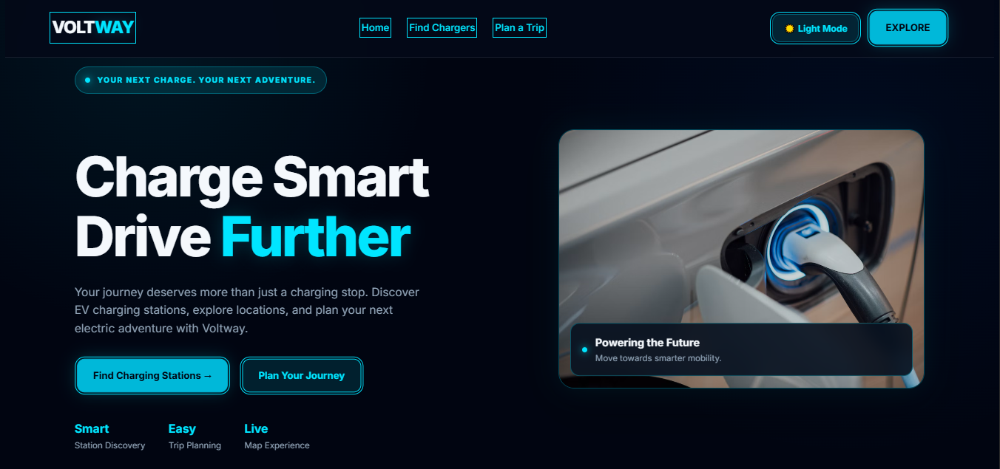
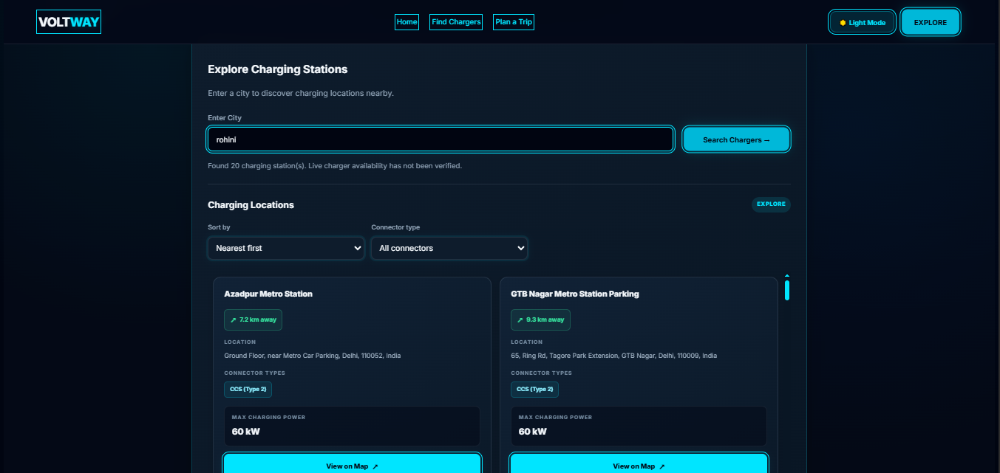
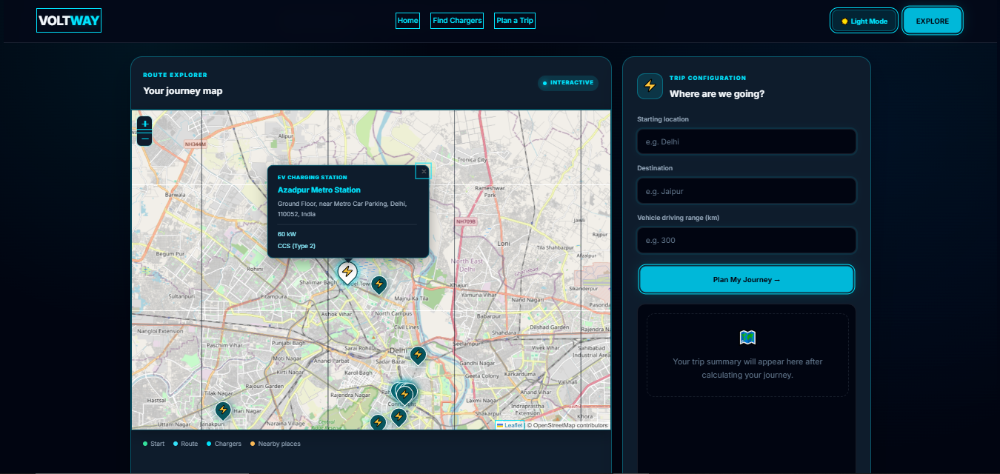
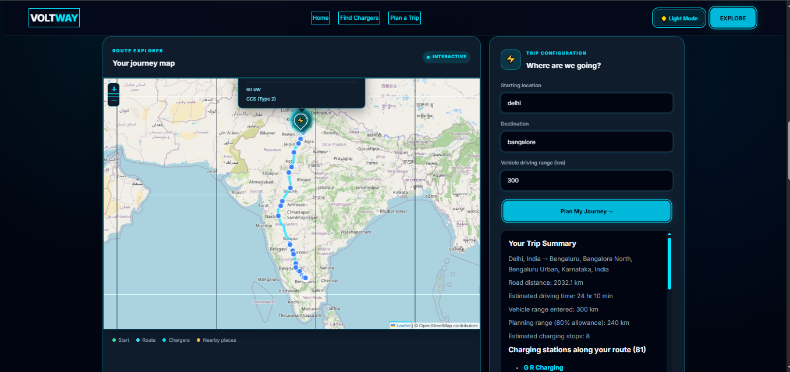
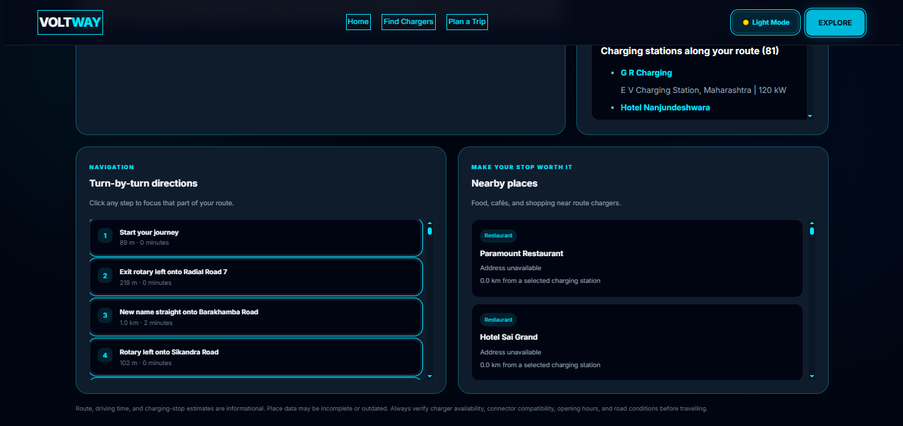

# ⚡ Voltway — EV Charging Station Finder & Smart Trip Planner

Voltway is a web-based electric vehicle (EV) charging station finder and smart trip planner designed to make electric vehicle journeys easier, smarter, and more convenient.

The application helps users discover EV charging stations across different cities, explore available charging options, and plan long-distance journeys with estimated charging stops along the route.

**Project Type:** MCA Minor Project  
**Developed by:** Itika Mittal & Tashvi Aggarwal  
**Institution:** JIMS (Jagan Institute of Management Studies)

---

## 🚀 Features

- **Charging Station Finder:** Search for EV charging stations across different cities and locations.
- **Interactive Map:** Explore charging stations, routes, and nearby places through an interactive map.
- **Smart Trip Planner:** Calculate road distance, estimated driving time, and charging stops based on vehicle range.
- **Route-Based Charging:** Discover charging stations along a planned journey.
- **Turn-by-Turn Directions:** View route directions and navigate to selected locations on the map.
- **Nearby Places:** Explore food and shopping options near charging stops.
- **Station Filters and Sorting:** Sort charging stations and filter them by connector type.
- **Dark and Light Themes:** Switch between two visual themes for a personalised experience.

---

## 📸 Screenshots

### Homepage


### Charging Station Finder


### Interactive Map


### Smart Trip Planner


### Trip Details and Navigation


---

---

## 🛠️ Technologies Used

### Frontend
- HTML5
- CSS3
- JavaScript
- Leaflet.js

### Backend
- Python
- Flask

### APIs and Services
- Open Charge Map API
- OpenStreetMap
- Nominatim Geocoding API
- OSRM Routing API
- Overpass API

---

## 📁 Project Structure

```text
Voltway/
│
├── backend/
│   └── app.py
│
├── index.html
├── style.css
├── script.js
├── start_voltway.bat
├── requirements.txt
├── .gitignore
├── README.md
└── screenshots/
```

---

## ⚙️ Setup and Installation

Follow these steps to run Voltway locally.

### 1. Clone the repository

```bash
git clone https://github.com/itika-mittal/Voltway.git
cd Voltway
```

### 2. Create a virtual environment

```bash
python -m venv venv
```

### 3. Activate the virtual environment

For Windows PowerShell:

```powershell
.\venv\Scripts\Activate.ps1
```

### 4. Install dependencies

```bash
pip install -r requirements.txt
```

### 5. Configure environment variables

Create a `.env` file inside the `backend` folder.

Add your Open Charge Map API key:

```env
OPENCHARGEMAP_API_KEY=your_api_key_here
```

**Note:** Keep your API key private. Never upload your `.env` file or expose API credentials publicly.

### 6. Start the Flask backend

From the main project directory, run:

```bash
python backend/app.py
```

### 7. Launch the frontend

Open `index.html` using VS Code Live Server or another local web server.

---

## 🎯 Project Objective

Voltway aims to simplify electric vehicle journey planning by bringing charging station discovery, route planning, charging stop estimation, and nearby place discovery together in one application.

The project focuses on improving convenience and accessibility for EV users by helping them make more informed decisions before and during their journeys.

---

## 👩‍💻 Project Team

**Developed collaboratively by:**

- **Itika Mittal**
- **Tashvi Aggarwal**

MCA Students  
JIMS – Jagan Institute of Management Studies

*An MCA Minor Project developed through collaborative effort.*

---

## 🔮 Future Enhancements

- Integration of real-time charging station availability.
- User accounts and saved journeys.
- Improved route optimisation based on charging station availability.
- Enhanced mobile responsiveness.
- Live deployment for public access.

---

**Voltway — Plan the Route. Never Miss a Charge.** ⚡
